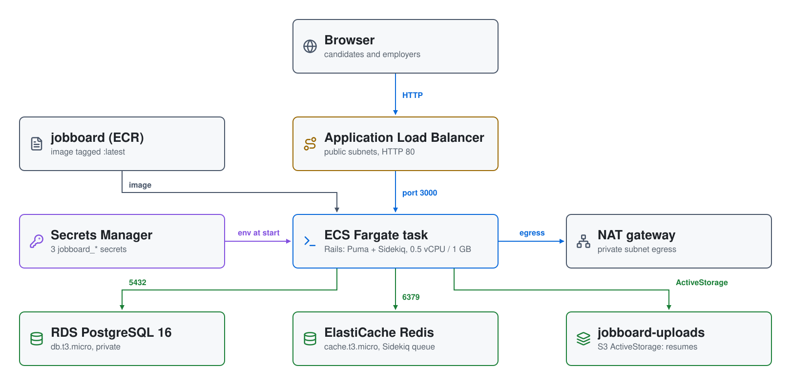

# Job Board on AWS: Ruby on Rails on ECS Fargate with RDS and Redis

A **job board** web app written in **Ruby on Rails 7.1** and run as one
container on **ECS Fargate** behind an **Application Load Balancer**.
**Candidates** browse jobs and apply with a cover letter and an uploaded
resume; **employers** set up a company profile, post jobs and review
applications. Data lives in **RDS PostgreSQL**, background jobs run on
**Sidekiq** backed by **ElastiCache Redis**, and resumes are stored in **S3**
through ActiveStorage. Devise handles accounts and Pundit enforces who can
see and change what.

| Piece | Where | Role |
|---|---|---|
| **VPC** | `10.0.0.0/23`, us-east-1 | two public and two private subnets across two AZs; a NAT gateway for the private subnets |
| **Application Load Balancer** | public subnets | HTTP 80 to the task on 3000; health check `/users/sign_in` |
| **ECS Fargate service** | private subnets | one task, 0.5 vCPU and 1 GB; `startup.sh` waits for the database, runs migrations and seeds, starts Sidekiq, then Puma; ECS Exec enabled; logs to `/ecs/jobboard` for 7 days |
| **RDS PostgreSQL 16** | private subnets | `db.t3.micro`, 20 GB, not public |
| **ElastiCache Redis 7** | private subnets | `cache.t3.micro`, one node; the Sidekiq queue |
| **jobboard-uploads-&lt;random&gt;** | S3 | private; ActiveStorage resume files |
| **jobboard** | ECR | the app image, tagged `latest` |
| **Secrets Manager** | us-east-1 | `jobboard_database_url`, `jobboard_redis_url`, `jobboard_secret_key_base`, injected into the task at start |

## Architecture

<picture>
  <source media="(prefers-color-scheme: dark)" srcset="architecture-dark.svg">
  
</picture>

Regenerate with `python3 make_diagram.py`.

- **`01-network/`**: the VPC and NAT gateway, RDS, ElastiCache, ECR, the
  uploads bucket and the secrets (database and Redis passwords are random).
- **`02-docker/jobboard/`**: the Rails app and its `Dockerfile`.
- **`03-ecs/`**: the load balancer, the cluster, task definition and service,
  the security groups and the two roles.

The load balancer's security group allows 80 from anywhere; the task's
allows 3000 only from the load balancer; PostgreSQL and Redis allow 5432 and
6379 from the VPC. The task's execution role pulls the image and reads the
three secrets; its runtime role can use the uploads bucket and ECS Exec.

## Demo users

The database is seeded on first start. Every account's password is
`password123`.

| Email | Role | Notes |
|---|---|---|
| `employer1@example.com` | Employer | Owns Acme Corp, 3 jobs posted |
| `employer2@example.com` | Employer | Owns Globex Industries, 3 jobs posted |
| `candidate1@example.com` | Candidate | Can apply to any job |
| `candidate2@example.com` | Candidate | Can apply to any job |

You can also register at `/users/sign_up` and pick a role.

## Prerequisites

* [An AWS Account](https://aws.amazon.com/console/)
* [Install AWS CLI](https://docs.aws.amazon.com/cli/latest/userguide/getting-started-install.html)
* [Install Terraform](https://developer.hashicorp.com/terraform/install)
* [Install Docker](https://docs.docker.com/engine/install/)
* [Install jq](https://jqlang.github.io/jq/download/)

If this is your first time following along, we recommend starting with this
video: [AWS + Terraform: Easy Setup](https://www.youtube.com/watch?v=9clW3VQLyxA).

## Deploy

```bash
git clone https://github.com/mamonaco1973/aws-jobs-board.git
cd aws-jobs-board
./apply.sh
```

`apply.sh` applies `01-network`, builds the image and pushes it to ECR as
`latest`, then applies `03-ecs`. It ends by running `validate.sh`, which
polls the sign-in page until it returns HTTP 200:

```
NOTE: Waiting for http://jobboard-alb-<id>.us-east-1.elb.amazonaws.com/users/sign_in to return HTTP 200...
NOTE: JobBoard is healthy (HTTP 200).
NOTE: URL: http://jobboard-alb-<id>.us-east-1.elb.amazonaws.com
```

## Try it

### As a candidate

1. Sign in as `candidate1@example.com` (or register a new Candidate account).
2. Browse the job listings at the home page. Use the keyword and location
   search fields to filter.
3. Click a job title to view the full description and salary range.
4. Click **Apply** to open the application form. Write a cover letter and
   attach your resume (PDF or Word; there is no size limit).
5. Submit — the employer receives an email notification via Sidekiq.
6. You cannot apply to the same job twice; the Apply button is replaced with
   an "Already Applied" notice on subsequent visits.

### As an employer

1. Sign in as `employer1@example.com` (or register a new Employer account).
2. On first login you are prompted to create a company profile if one does not
   exist. Fill in the company name, location, website, and description.
3. Post new jobs from the job listing page using **Post a Job**.
4. Navigate to **Employer Dashboard** to see all your posted jobs and the
   number of applications received.
5. Click a job in the dashboard to see each application, the candidate's cover
   letter, and a link to download their uploaded resume.
6. Update an application's status (Pending → Reviewed → Accepted / Rejected)
   from the application detail page.

## Teardown

```bash
./destroy.sh
```

## Notes

- **Lab only.** The app, including sign-in, is plain HTTP; anyone can
  register; the seeded accounts share a known password.
- Production mail uses SMTP, but no SMTP server is configured and delivery
  errors are ignored, so the application notification emails Sidekiq sends
  go nowhere.
